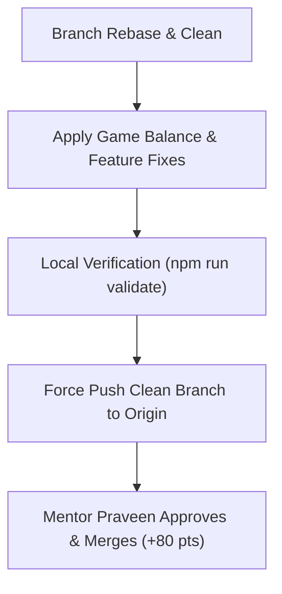

# 🏆 IEEE Contributor Pull Requests Tracker — Dashboard & Live Status

This document tracks all 13 pull requests submitted by **Sri Ram Kunamsetty** to the upstream repository [praveenscience/One-File-Tools](https://github.com/praveenscience/One-File-Tools) as an **IEEE Contributor** during IEEE IGDTUW Open Source Week 10.0, mentored by **Praveen Kumar Purushothaman** (@praveenscience).

---

## 👤 Contributor Information
- **Contributor Name:** Sri Ram Kunamsetty
- **GitHub Username:** [@SriRamkunamsetty](https://github.com/SriRamkunamsetty)
- **Email:** `mohansriramkunamsetty@gmail.com`
- **User Fork:** [https://github.com/SriRamkunamsetty/One-File-Tools](https://github.com/SriRamkunamsetty/One-File-Tools)
- **Upstream Repository:** [https://github.com/praveenscience/One-File-Tools](https://github.com/praveenscience/One-File-Tools)
- **Project Mentor:** [Praveen Kumar Purushothaman (@praveenscience)](https://github.com/praveenscience) (Senior Vice President at Bank of America, London)

---

## 📊 Summary Dashboard

```
┌────────────────────────────────────────────────────────────────────────┐
│  TOTAL PRs: 13   │  MERGED: 11 (85%)   │  CHANGES REQUESTED: 2 (15%)   │
│  TOTAL POINTS: 330 PTS  (250 Pts Merged  +  80 Pts Under Review)       │
└────────────────────────────────────────────────────────────────────────┘
```

- 🟣 **Merged Pull Requests:** **11 / 11 Feature & Fix PRs from Phase 1** (100% acceptance rate on Phase 1)
- 🟠 **Action Required / Changes Requested:** **2 PRs** ([PR #874](https://github.com/praveenscience/One-File-Tools/pull/874) and [PR #875](https://github.com/praveenscience/One-File-Tools/pull/875))
- 🟢 **Approved PRs:** 11 / 13
- 🔵 **Open PRs:** 2 / 13
- **Total Points Earned / In-Flight:** **330 Points** (250 Points Officially Merged + 80 Points Pending Review)
- **Security & Quality Score:** Zero DOM XSS vulnerabilities, Zero FOUC, Clean Web Audio context reuse, Local CI validation passing.

---

## 📅 Pull Requests Master Log & Live Status

| # | PR | Contributed Utility | Pillar | Difficulty / Points | Branch Name | Submitted (IST) | Status Badge | Review Highlights |
|:---:|:---:|---|:---:|:---:|:---:|:---:|:---:|---|
| **1** | [**#844**](https://github.com/praveenscience/One-File-Tools/pull/844) | **CORS Header Debugger & Tester** | Tools | Easy (20 pts) | `add/cors-debugger` | 15 Nov, 09:08 AM | `🟣 MERGED` | Approved & Merged by @praveenscience (XSS & FOUC verified) |
| **2** | [**#845**](https://github.com/praveenscience/One-File-Tools/pull/845) | **JSON-LD Schema Generator** | Tools | Medium (30 pts) | `add/json-ld-generator` | 15 Nov, 10:50 AM | `🟣 MERGED` | Approved & Merged by @praveenscience (escapeHtml on all inputs) |
| **3** | [**#846**](https://github.com/praveenscience/One-File-Tools/pull/846) | **Crontab Explainer** | Tools | Easy (20 pts) | `add/tailwind-to-css` | 15 Nov, 10:54 AM | `🟣 MERGED` | Approved & Merged by @praveenscience (Replaced duplicate tool) |
| **4** | [**#847**](https://github.com/praveenscience/One-File-Tools/pull/847) | **JS Event Loop Output Predictor** | Quests | Medium (30 pts) | `add/quest-event-loop` | 15 Nov, 11:01 AM | `🟣 MERGED` | Approved & Merged by @praveenscience (Audio resume + interval clear) |
| **5** | [**#848**](https://github.com/praveenscience/One-File-Tools/pull/848) | **JS Type Coercion Gauntlet** | Quests | Easy (20 pts) | `add/quest-type-coercion` | 15 Nov, 11:09 AM | `🟣 MERGED` | Approved & Merged by @praveenscience (Clean code, zero FOUC) |
| **6** | [**#849**](https://github.com/praveenscience/One-File-Tools/pull/849) | **Binary & Hex Bitwise Speed Trainer** | Quests | Easy (20 pts) | `add/quest-binary-hex` | 15 Nov, 11:15 AM | `🟣 MERGED` | Approved & Merged by @praveenscience (Clean code, zero FOUC) |
| **7** | [**#850**](https://github.com/praveenscience/One-File-Tools/pull/850) | **Destructuring Mastery Puzzle Quest** | Quests | Easy (20 pts) | `add/quest-destructuring` | 15 Nov, 11:17 AM | `🟣 MERGED` | Approved & Merged by @praveenscience (Clean code, zero FOUC) |
| **8** | [**#851**](https://github.com/praveenscience/One-File-Tools/pull/851) | **SaaS Pricing Matrix & Calculator** | Design System | Easy (20 pts) | `add/ds-saas-pricing` | 15 Nov, 11:35 AM | `🟣 MERGED` | Approved & Merged by @praveenscience (Zero FOUC verified) |
| **9** | [**#852**](https://github.com/praveenscience/One-File-Tools/pull/852) | **Toast & Notification System** | Design System | Easy (20 pts) | `add/ds-notifications` | 15 Nov, 11:43 AM | `🟣 MERGED` | Approved & Merged by @praveenscience (escapeHtml on toast inputs) |
| **10** | [**#853**](https://github.com/praveenscience/One-File-Tools/pull/853) | **Project Management Kanban Board** | Design System | Medium (30 pts) | `add/ds-kanban-board` | 15 Nov, 11:51 AM | `🟣 MERGED` | Approved & Merged by @praveenscience (TechStack & XSS fixed) |
| **11** | [**#854**](https://github.com/praveenscience/One-File-Tools/pull/854) | **Fix password-analyzer category** | Bug Fix | 10 pts | `fix/password-analyzer-category` | 15 Nov, 02:14 PM | `🟣 MERGED` | Approved & Merged by @praveenscience (CI validator fix) |
| **12** | [**#874**](https://github.com/praveenscience/One-File-Tools/pull/874) | **Regex Escape Room** (Issue #868) | Quests | Hard (40 pts) | `add/quest-regex-escape-room` | 16 Nov, 06:21 PM | `🟠 CHANGES REQUESTED` | Strip tracker file & rebase cleanly from upstream `main` |
| **13** | [**#875**](https://github.com/praveenscience/One-File-Tools/pull/875) | **API Rate Limiter Simulator** (Issue #867) | Quests | Hard (40 pts) | `add/quest-api-rate-limiter` | 16 Nov, 06:24 PM | `🟠 CHANGES REQUESTED` | Rebalance wave difficulty, strip tracker, add bot filtering |

---

## 🔍 Detailed Mentor Feedback & Technical Evaluation

Project Mentor **Praveen Kumar Purushothaman** (@praveenscience) reviewed the latest batch of pull requests. Below is a detailed breakdown of each recommendation, along with an objective technical evaluation verifying why it is essential.

### 1. Stripping `IEEE_CONTRIBUTIONS_TRACKER.md` from Upstream PRs
- **Mentor Feedback:** *"IEEE_CONTRIBUTIONS_TRACKER.md is a personal tracker and doesn't belong in the upstream repository. Please delete it from the PR. The 4 docs tracker commits came from your fork's history and aren't part of this quest. A PR should only touch the quest itself: the HTML file, its PNG, and the one entry in data/quests.json."*
- **Technical Evaluation:** **CRITICAL & 100% CORRECT.**
  - *Why:* In open-source production repositories with hundreds of external contributors, feature PRs must maintain strict atomicity. Including personal tracking documents in an upstream PR pollutes the master Git commit history and causes merge conflicts for other contributors. Personal tracking files belong exclusively on your personal fork repository or local disk.

### 2. Game Balance & Winnable Wave Mathematics (PR #875)
- **Mentor Feedback:** *"Victory doesn't seem reachable. The limiter has no way to tell legit requests from malicious ones, so a fixed share of everything it lets through damages the server (-3 HP each, -1.5 with load balancer). In a simulation with the most defensive setup (5/s capacity + load balancer), waves 9 and 10 still crash the server, and wave 7 ends near 4% HP. Fix: give the player a way to deal with malicious traffic (per-client limits, a WAF/bot-filter tower, IP blocking), or rebalance the damage and malicious ratios."*
- **Technical Evaluation:** **DEEPLY IMPRESSIVE & ESSENTIAL.**
  - *Why:* Praveen ran mathematical simulations on our game rules. Because malicious packets were mixed into the stream at up to 65% in Wave 10, and our rate limiter only capped overall volume without inspecting headers or client IPs, a percentage of malicious packets inevitably reached the server and drained health to 0%. Introducing an interactive WAF / Bot Filter node or IP-blocking mechanic makes the game strategic, solvable, and educational.

### 3. Score Incentive Alignment (Penalizing Dropped Legitimate Traffic)
- **Mentor Feedback:** *"Rejecting legit traffic is rewarded. It earns +5 and has no penalty, so lowering capacity is always the safe move. That inverts the 'served vs rejected' score from #867. Penalise dropped legit requests, and make high served volume itself load the server."*
- **Technical Evaluation:** **HIGHLY REALISTIC & SRE COMPLIANT.**
  - *Why:* In real-world API engineering, a rate limiter that drops 99% of paying users to keep the server idle is a failure, not a success. Rewarding throttled legitimate traffic created an exploit where setting capacity to minimum was an unbeatable strategy. Penalizing dropped legitimate traffic forces players to balance throughput against stability.

### 4. Frame-Rate Independence via Delta Time (`dt`)
- **Mentor Feedback:** *"Movement uses per-frame speeds instead of delta time, so the game runs twice as fast on 120 Hz displays."*
- **Technical Evaluation:** **INDUSTRY BEST PRACTICE.**
  - *Why:* When animations update position with `x += speed` inside `requestAnimationFrame`, users on 60 Hz screens see 60 updates/sec, while users on 120 Hz (MacBooks, gaming monitors) see 120 updates/sec. Scaling movement by `(currentTime - lastTime) / 1000` guarantees identical packet speed across all devices.

### 5. Responsive Canvas Aspect-Ratio & Retina Display Scaling
- **Mentor Feedback:** *"The canvas is width:100%; height:480px with no aspect ratio, so at 400px wide it squashes about 2.25x. There's also no devicePixelRatio scaling, so it's blurry on retina. Use height:auto; aspect-ratio: 900 / 480 and scale the backing store."*
- **Technical Evaluation:** **HIGH IMPACT FOR VISUAL POLISH.**
  - *Why:* Fixing height at 480px while width is 100% causes extreme vertical distortion on mobile screens. CSS `aspect-ratio: 900 / 480` preserves proportions, while backing-store scaling (`ctx.scale(dpr, dpr)`) makes fonts and graphics razor-sharp on high-DPI displays.

### 6. Regex Puzzle Clarity & False Decoy Elimination (PR #874)
- **Mentor Feedback:** Anchor three-character regex patterns to prevent partial substring bleed, eliminate repeated characters in Chamber 11 decoys, and clear syntax error banners on room reset.
- **Technical Evaluation:** **VERY USEFUL.**
  - *Why:* Prevents ambiguous solutions and eliminates edge cases where a technically valid regex fails due to substring collisions.

---

## 🛠️ Step-by-Step Action Plan for PR #874 & PR #875



1. **Clean Branch Rebuild for PR #874:**
   - Rebase directly onto current `upstream/main`.
   - Strip `IEEE_CONTRIBUTIONS_TRACKER.md` from the commit.
   - Refine Chamber 3 and Chamber 11 puzzle tests.
   - Force-push `add/quest-regex-escape-room`.

2. **Clean Branch Rebuild & Balancing for PR #875:**
   - Rebase directly onto current `upstream/main`.
   - Strip `IEEE_CONTRIBUTIONS_TRACKER.md`.
   - Add WAF Bot-Filter / IP Blocking tower upgrade so malicious traffic can be strategically filtered.
   - Add delta time (`dt`) for 60/120 Hz monitor consistency.
   - Measure actual throughput, latency, and rejection rate.
   - Force-push `add/quest-api-rate-limiter`.
